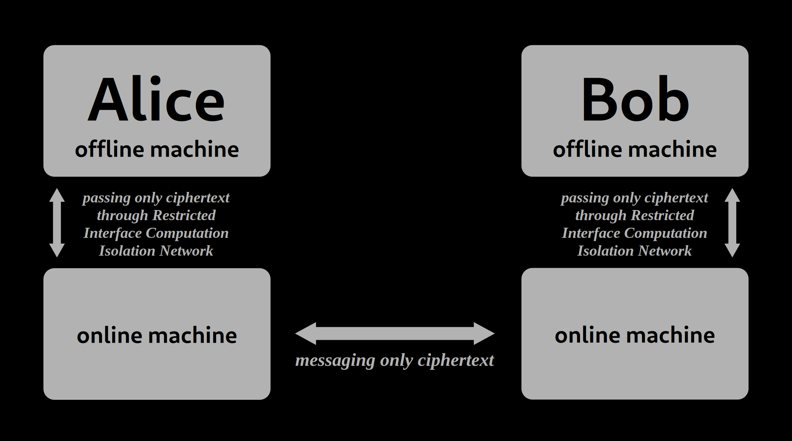

### Run it

```apt install g++ geany```. Open the .cpp in Geany. Hit F9 once. F5 to run.

<br>

### Terminal

```text
(1) Get keys
(2) Encrypt outgoing file
(3) Decrypt received file

Option: |
```

<br>

### How it works

```text
          you make 5 keys:     1       2       3       4       5
       user 2 gets copies:     1       2       3       4       5
       user 3 gets copies:     1       2       3       4       5
       user 4 gets copies:     1       2       3       4       5
       user 5 gets copies:     1       2       3       4       5


                               ^                               ^
                          with which                      with which
                       you encrypt, and                user 5 encrypts,
                        others decrypt                and others decrypt


Send in the order encrypted, and decrypt in the order received! Keys are lines of
text that are a rolling-seed, which is used to generate pseudorandom bytes 0-255.
```

<br>

### Perfect secrecy proof

```text
             key  523872537481693327099241416092                  0 1 2 3 4 5 6 7 8 9
       plaintext  792342222222222000000945053749
      ciphertext  215114759603815327099186469731              0   0 1 2 3 4 5 6 7 8 9
                  ^                                           1   1 2 3 4 5 6 7 8 9 0
                                                              2   2 3 4 5 6 7 8 9 0 1
                                                              3   3 4 5 6 7 8 9 0 1 2
(5+7) mod 10 = 2. The full 10-symbol mod table on the         4   4 5 6 7 8 9 0 1 2 3
right proves the plaintext could be any of  10 digits         5   5 6 7 8 9 0 1 2 3 4
(2 appears 10 times  in the table).  No guess-key  is         6   6 7 8 9 0 1 2 3 4 5
rejected; complete brute-force  cannot  determine the         7   7 8 9 0 1 2 3 4 5 6
usefulness of any key.  Only the key owners know that         8   8 9 0 1 2 3 4 5 6 7
7 was intended.  Extend the table  to 255 for  files.         9   9 0 1 2 3 4 5 6 7 8
```

<sup>Original discoverer of the One-time pad (perfect secrecy) is not mentioned as I had independently rediscovered it ~December 2019</sup>

<br>

### Security

* Uses my https://github.com/compromise-evident/rolling-code

<br>

### Recommended setup for chatting securely

<p align="center">
  
</p>
